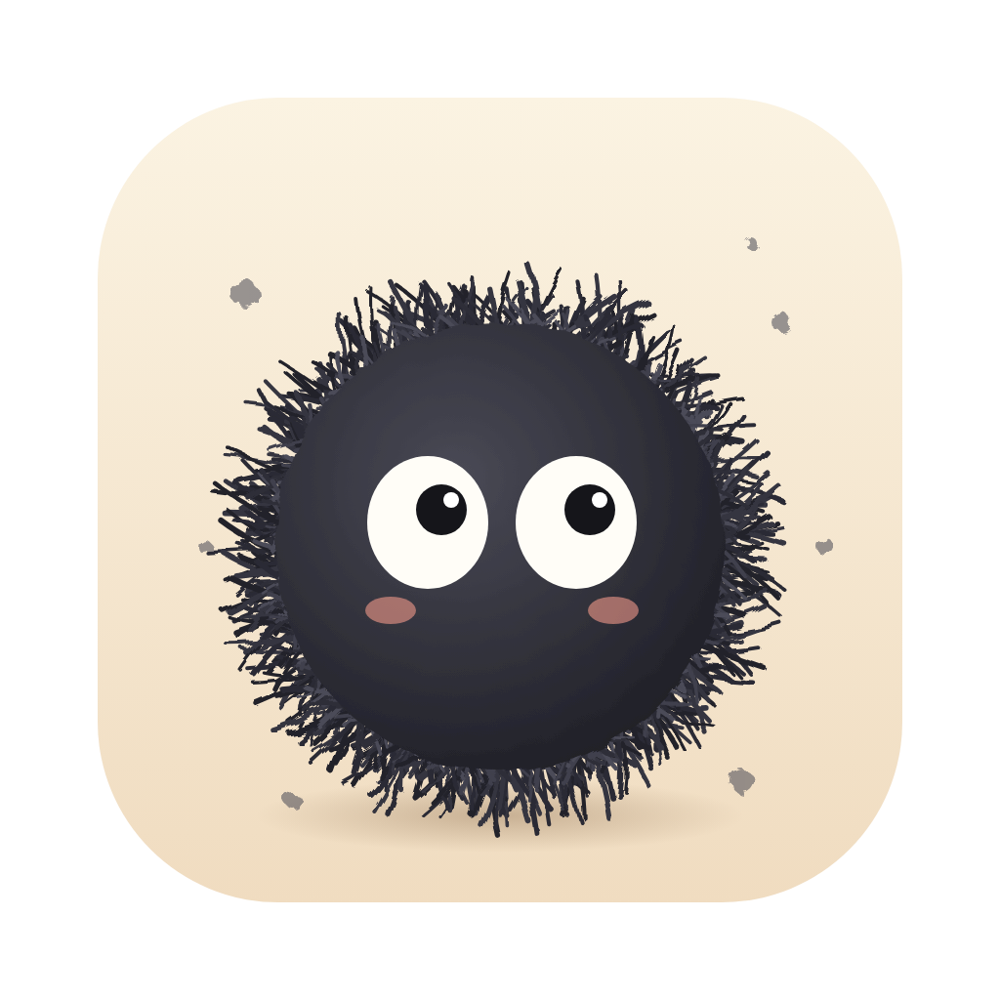

<p align="center">
  
</p>

<h1 align="center">Kurz</h1>

<p align="center">
  Aplikacja na macOS, która pokazuje, co zajmuje miejsce na dysku, i pomaga je bezpiecznie odzyskać.
</p>

---

## Co robi

Kurz skanuje folder domowy, buduje drzewo rozmiarów wszystkich plików i folderów, a potem pokazuje je w formie, w której od razu widać, gdzie „zbiera się kurz”.

| Funkcja | Status |
|---|---|
| Szybki, równoległy skan folderu z postępem na żywo i możliwością anulowania | ✅ gotowe |
| Lista największych pozycji z nawigacją w głąb folderów | ✅ gotowe |
| Informacje o dysku: pojemność, zajęte i wolne miejsce | 🚧 w trakcie |
| Mapa kafelkowa (treemap): wielkość kafelka odpowiada zajmowanemu miejscu, kliknięcie wchodzi do folderu | 🚧 w trakcie |
| Kolorowanie według kategorii: dokumenty, kod, SDK, modele AI, cache pakietów | 📋 planowane |
| Rekomendacje „bezpieczne do usunięcia” i „do przejrzenia”, np. cache npm, `.next`, DerivedData, modele Ollama | 📋 planowane |
| Czyszczenie przez przeniesienie do Kosza albo skopiowanie gotowego skryptu shell | 📋 planowane |

### Zasady bezpieczeństwa

- Kurz **nigdy nie usuwa plików na stałe**. Usuwanie zawsze przenosi do Kosza, z którego można je przywrócić.
- Nic nie dzieje się bez zaznaczenia przez Ciebie. Rekomendacje to tylko podpowiedzi.
- Skan tylko czyta i niczego na dysku nie zmienia.

## Jak to działa

```
┌──────────────────────────── Kurz.app ─────────────────────────────┐
│                                                                   │
│  Interfejs (React + TypeScript, w webview systemu)                │
│    • kafelki z informacjami, mapa, lista, rekomendacje            │
│    • układ mapy liczony przez d3-hierarchy (squarified treemap)   │
│                 ▲ zdarzenia: postęp, koniec skanu                 │
│                 │ polecenia: start_scan, get_tree, disk_info      │
│  Rdzeń (Rust)   ▼                                                 │
│    • scanner.rs: równoległe przejście po katalogach (rayon)       │
│    • disk.rs: pojemność wolumenu (statfs)                         │
│    • drzewo rozmiarów trzymane w pamięci                          │
└───────────────────────────────────────────────────────────────────┘
```

1. **Skan.** Rust przechodzi po katalogach równolegle na wszystkich rdzeniach procesora. Każdy podfolder to osobne zadanie dla puli wątków rayon. Co 150 ms do interfejsu trafia zdarzenie z postępem: liczba plików, folderów, bajtów i błędów.
2. **Liczenie rozmiaru.** Kurz liczy miejsce faktycznie zajęte na dysku (`st_blocks × 512`), tak jak `du`, a nie rozmiar „logiczny”. Dzięki temu pliki rzadkie i skompresowane nie zawyżają wyniku.
3. **Pułapki, które skaner omija:**
   - nie wchodzi w dowiązania symboliczne, więc niczego nie liczy dwa razy i nie wpada w pętle;
   - pomija inne woluminy zamontowane wewnątrz skanowanego folderu;
   - plik z kilkoma twardymi dowiązaniami liczy tylko raz;
   - folder bez uprawnień zalicza jako „nieczytelny” i skanuje dalej.
4. **Drzewo w pamięci.** Wynik skanu to drzewo w pamięci procesu Rust. Interfejs pobiera tylko fragment, który akurat pokazuje (`get_tree(path, depth)`). Pozycje zbyt małe, by były widoczne, są łączone w jedną, więc nawet przy milionach plików do interfejsu trafia niewiele danych.

**Bazy danych nie ma i nie jest potrzebna.** Drzewo z ~3 mln plików mieści się w kilkuset MB RAM i powstaje od nowa przy każdym skanie. Na dysk w przyszłości trafią najwyżej ustawienia (mały plik JSON) i ewentualnie cache ostatniego skanu.

## Dlaczego takie technologie

**Rust: rdzeń i skaner.** Skanowanie dysku to miliony wywołań systemowych i sporo pracy procesora. Rust daje:
- wydajność na poziomie C bez garbage collectora, co ma znaczenie przy milionach obiektów w drzewie;
- bezpieczne wielowątkowe przechodzenie po katalogach; z rayon to kilka linijek, a kompilator pilnuje, żeby nie było wyścigów;
- bezpośredni dostęp do API systemu (`statfs`, metadane plików) bez dodatkowych warstw.

Przykład: skan `~/Prywatne` (9,5 GB, 188 tys. plików) trwa 2,3 s w wersji release.

**Tauri 2: szkielet aplikacji.** Łączy rdzeń w Rust z interfejsem webowym:
- apka jest mała, kilka MB, bo korzysta z wbudowanego w macOS WebKitu, zamiast dołączać całego Chromium jak Electron;
- komunikacja Rust ↔ interfejs to proste polecenia i zdarzenia;
- system uprawnień pozwala interfejsowi tylko na to, co jawnie dopuszczone;
- w razie potrzeby da się zbudować wersję na Windows i Linuksa.

**React + TypeScript: interfejs.** Interaktywne wizualizacje (mapa, zaznaczanie, panele) najwygodniej robi się w technologiach webowych. TypeScript pilnuje zgodności typów z tym, co zwraca Rust.

**d3-hierarchy: układ mapy.** Sprawdzona implementacja algorytmu squarified treemap, który dzieli prostokąt na kafelki o proporcjach jak najbliższych kwadratu. Używamy tylko liczenia układu, rysuje React.

**Vite + pnpm: budowanie interfejsu.** Vite daje błyskawiczny serwer deweloperski z natychmiastowym przeładowaniem. pnpm jest szybki i oszczędny na miejscu na dysku, co przy aplikacji do sprzątania dysku wypada docenić.

## Uruchomienie

### Wymagania

- macOS 11 lub nowszy
- [Rust](https://rustup.rs) (stable)
- [Node.js](https://nodejs.org) 20+ i [pnpm](https://pnpm.io)
- Xcode Command Line Tools: `xcode-select --install`

### Tryb deweloperski

```bash
pnpm install
pnpm tauri dev
```

Otwiera okno aplikacji z automatycznym przeładowaniem po zmianach w interfejsie i w Rust.

### Budowanie aplikacji

```bash
pnpm tauri build
```

Gotowa aplikacja trafia do `src-tauri/target/release/bundle/macos/Kurz.app`, a instalator do `src-tauri/target/release/bundle/dmg/`.

### Testy

```bash
cd src-tauri && cargo test
```

### Pomiar szybkości skanera z wiersza poleceń

```bash
cd src-tauri && cargo run --release --example scan -- ~/Projects
```

### Uprawnienia macOS

Przy pierwszym skanie macOS zapyta o dostęp do Biurka, Dokumentów i Pobranych. Żeby przeskanować wszystko, także dane aplikacji w `~/Library`, nadaj Kurz pełny dostęp do dysku: **Ustawienia systemowe → Prywatność i ochrona → Pełny dostęp do dysku**. Bez tego część folderów pojawi się jako „nieczytelne”.

## Struktura projektu

```
kurz/
├── src/                    # interfejs (React + TypeScript)
│   ├── App.tsx
│   └── lib/                # wywołania Rusta, formatowanie
├── src-tauri/              # rdzeń (Rust)
│   ├── src/scanner.rs      # równoległy skaner + testy
│   ├── src/disk.rs         # informacje o wolumenie
│   ├── src/lib.rs          # polecenia i zdarzenia Tauri
│   ├── examples/scan.rs    # benchmark z linii poleceń
│   └── tauri.conf.json     # konfiguracja okna i paczki
└── design/                 # ikona (źródło SVG i PNG 1024×1024)
```

## Jak powstaje ten projekt

Kurz jest budowany agentowo, z agentem AI (Claude Code), **na czystych promptach**:

- **Bez skilli.** Nie używamy gotowych skilli ani własnych zestawów instrukcji dla agenta. Każdy krok to zwykła rozmowa: opis, czego chcemy, screen albo uwaga do wyniku.
- **Bez wiki.** Nie prowadzimy osobnej bazy wiedzy ani dokumentacji dla agenta. Źródłem prawdy są kod, testy, historia gita i ten README.
- **Lekko.** Apka ma być mała i szybka: minimum zależności, bez bazy danych, bez serwera, bez ciężkich frameworków. Każdą nową zależność trzeba uzasadnić.

Pracujemy małymi krokami: plan etapu, implementacja, testy, commit. Każdy commit jest podpisany jako współtworzony z agentem.

## Ikona

Puchata kulka kurzu z dużymi oczami, inspirowana klimatem filmów studia Ghibli. To oryginalna grafika, narysowana w SVG na potrzeby tego projektu. Źródło: [`design/icon.svg`](design/icon.svg).
